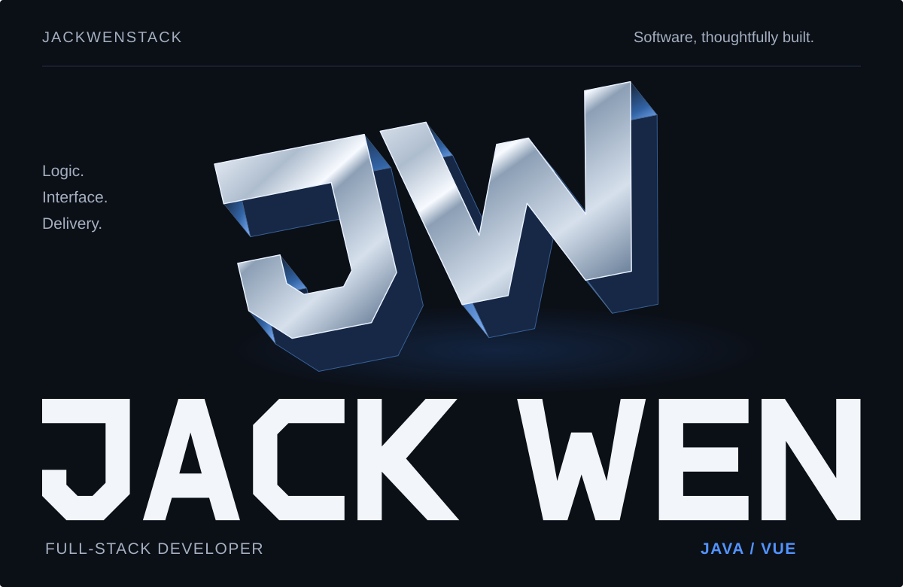
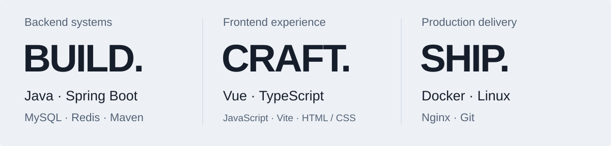

<picture>
  <source media="(max-width: 900px)" srcset="./assets/hero-mobile.svg">
  
</picture>

 

<h3 align="center">系统有章法，体验有细节。</h3>

  我是 <strong>Jack Wen</strong>，专注 Java 后端与 Vue 前端的全栈开发者。 
  从业务逻辑到用户界面，让想法成为可靠、清晰、易维护的软件。

 

<picture>
  <source media="(max-width: 900px)" srcset="./assets/practice-mobile.svg">
  
</picture>

 

<picture>
  <source media="(max-width: 900px) and (prefers-reduced-motion: reduce)" srcset="https://raw.githubusercontent.com/JackWenStack/JackWenStack/output/contribution-signal-mobile-still.svg">
  <source media="(prefers-reduced-motion: reduce)" srcset="https://raw.githubusercontent.com/JackWenStack/JackWenStack/output/contribution-signal-still.svg">
  <source media="(max-width: 900px)" srcset="https://raw.githubusercontent.com/JackWenStack/JackWenStack/output/contribution-signal-mobile.svg">
  
</picture>

 

<a href="https://github.com/JackWenStack">
  <picture>
    <source media="(max-width: 900px)" srcset="./assets/signoff-mobile.svg">
    
  </picture>
</a>
